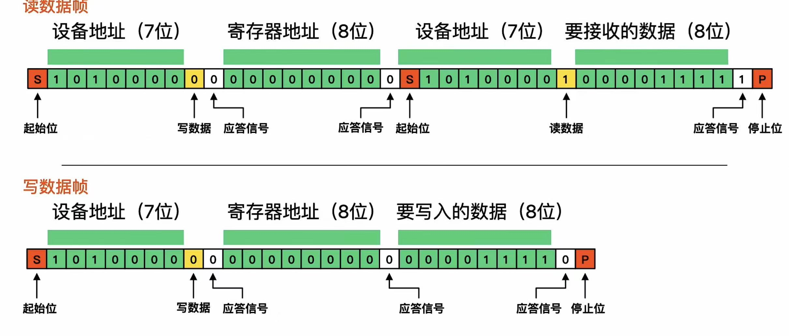

- 全双工、半双工通信分别指的是什么？

特点：
- 全双工：同时进行数据的发送和接收。
- 半双工：数据发送和接收不能同时进行，需要分时进行。

i2c 实现原理：总线通讯 一主多从 半双工通信 
- i2c 通信使用两条线：SCL（时钟线）和 SDA（数据线）。
  空闲时 都处于高电平状态 
  起始：SCL 高电平，SDA 下降电平 
  1 0 表示： 同为高电平1 SCL高SDA低为0 
  7位设备地址码 + 读写控制位（读1写0） +应答信号+ 寄存器地址 + 数据 + 停止信号(上升沿)

- 主设备通过 SCL 线发送时钟信号，通过 SDA 线发送数据。
- 从设备通过 SDA 线接收数据，并通过 SCL 线接收时钟信号。
- 主设备通过 SDA 线发送地址和数据，从设备通过 SDA 线接收地址和数据。
- 主设备通过 SCL 线发送停止信号，表示通信结束。

## I2C 读写数据帧

