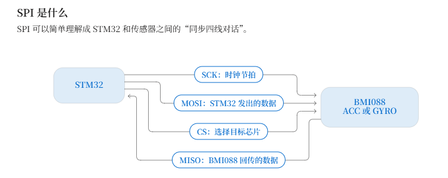
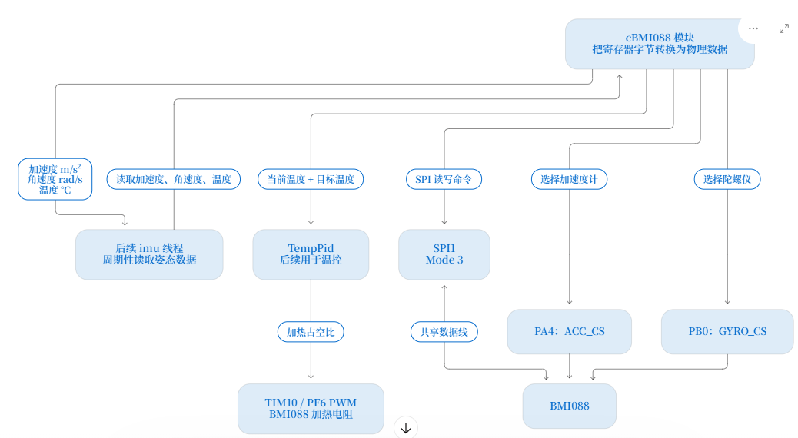
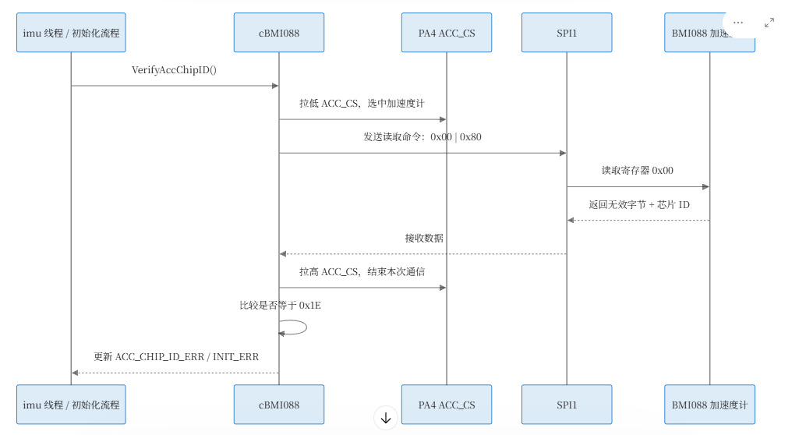

# SPI 与 BMI088 通信笔记

本文记录当前项目中 STM32 与 BMI088 的 SPI 连接、一次寄存器读取的过程，以及 BMI088 模块在后续系统中的位置。目标是先理解数据如何流动，再实现 `modules/BMI088` 中的代码。

## 1. SPI 是什么

SPI 可以理解为 STM32 与传感器之间的“同步四线对话”。STM32 是通信的发起者，负责产生时钟、选择目标芯片，并发送读写命令。



| 信号 | 方向 | 作用 |
| --- | --- | --- |
| `SCK` | STM32 → BMI088 | 时钟节拍。每个时钟节拍推动双方发送或读取下一位数据。 |
| `MOSI` | STM32 → BMI088 | STM32 发出的命令、寄存器地址和配置数据。 |
| `MISO` | BMI088 → STM32 | BMI088 返回的芯片 ID、传感器原始数据等。 |
| `CS` | STM32 → BMI088 | 选择本次通信的目标芯片。低电平表示被选中。 |

当前板级配置使用 SPI1 的 Mode 3。具体的时钟极性和采样边沿已由 CubeMX 配置；BMI088 模块只需按要求使用 SPI1 完成收发。

## 2. BMI088 与 STM32 的实际连接

BMI088 内部包含两颗逻辑上独立的传感器：加速度计 ACC 和陀螺仪 GYRO。它们共用 `SCK`、`MOSI`、`MISO` 三根 SPI 通信线，但各自拥有一根片选线。



本项目的连接关系：

```text
PB3  = SPI1_SCK
PA7  = SPI1_MOSI
PB4  = SPI1_MISO

PA4  = ACC_CS   （选择加速度计）
PB0  = GYRO_CS  （选择陀螺仪）
```

`SCK / MOSI / MISO` 始终物理连接到 BMI088，并不会因 CS 改变而断开。CS 的作用更像“发言许可”：

```text
ACC_CS = 低，GYRO_CS = 高：只有加速度计响应 SPI 命令。
ACC_CS = 高，GYRO_CS = 低：只有陀螺仪响应 SPI 命令。
ACC_CS = 高，GYRO_CS = 高：两颗芯片都不响应，SPI 总线空闲。
```

一次通信只能选中一颗芯片。若两根 CS 同时为低，ACC 和 GYRO 都可能同时驱动共享的 `MISO` 返回线，导致读到的内容不可靠。

## 3. 一次读取 Chip ID 的过程

Chip ID 是最适合作为首次通信验证的数据：它位于固定寄存器地址，预期值明确，能够确认 SPI 线路、CS 选择和芯片类型都正确。



读取加速度计 Chip ID 的顺序：

1. 将 `ACC_CS` 拉低，选中加速度计。
2. 发送“读取地址 `0x00`”的命令。SPI 读操作使用地址最高位作为读标志，因此命令为 `0x00 | 0x80 = 0x80`。
3. STM32 继续提供 SPI 时钟，同时通过 `MISO` 接收 BMI088 返回的数据。
4. 将 `ACC_CS` 拉高，结束本次通信。
5. 比较返回的 Chip ID 是否为加速度计预期值 `0x1E`；不一致时设置 `ACC_CHIP_ID_ERR` 和 `INIT_ERR`。

陀螺仪的流程完全相同，只是选中 `GYRO_CS`，并检查预期 Chip ID `0x0F`。

### 加速度计的无效占位字节

BMI088 加速度计在 SPI 读操作中会先返回一个无效占位字节，随后才返回真正的寄存器数据；陀螺仪不需要这个额外字节。

本项目采用 **方案 B**：`ReadReg()` 在内部处理 ACC 的无效字节，对外只返回有效寄存器数据。调用者不需要重复记忆或跳过该字节。

```cpp
uint8_t acc_chip_id;
ReadReg(BMI088_CS_ACC, ACC_CHIP_ID_ADDR, &acc_chip_id, 1);

// acc_chip_id 直接是有效的 0x1E，而不是无效占位字节。
```

这项约定会让后续的 Chip ID 校验、三轴数据读取和温度读取共享一致的接口。

## 4. BMI088 模块处于系统的什么位置

`cBMI088` 的职责是把 SPI 收到的寄存器字节转换为其他模块可使用的物理数据。它不是线程，也不决定多久读取一次；后续 `imu` 线程才负责周期性调用它。

```text
下游硬件：SPI1、ACC_CS、GYRO_CS、TIM10/PF6 PWM
        ↓
cBMI088：读写寄存器、配置、解析、标定、温控
        ↓
上游软件：imu 线程读取加速度、角速度和温度
```

各数据的去向：

| 数据或操作 | 模块内含义 | 后续使用者 |
| --- | --- | --- |
| 加速度 | 原始有符号数值换算为 `m/s²` | imu 线程与姿态相关算法 |
| 角速度 | 原始有符号数值换算为 `rad/s`，再减去零偏 | imu 线程与姿态相关算法 |
| 温度 | 解析为 `°C` | 温控 PID |
| 温控输出 | `TempPid` 根据目标温度计算加热量 | TIM10 / PF6 PWM，加热电阻 |

## 5. BMI088 的完整生命周期


后续实现按以下顺序推进：

```text
CubeMX 初始化 GPIO / SPI1 / TIM10
    ↓
Config()：复位并配置量程、采样率、带宽
    ↓
VerifyAccChipID() 与 VerifyGyroChipID()：确认通信和芯片身份
    ↓
Calibrate()：机器人静止时估计陀螺仪零偏
    ↓
ReadAccData() / ReadGyroData() / ReadAccTemperature()
    ↓
原始寄存器字节换算为 m/s²、rad/s、°C
    ↓
imu 线程周期性读取并提供给后续逻辑
```

温控是与数据读取并行的后续功能：温度读数作为反馈值，`TempPid` 计算加热输出，再通过 `TIM10 / PF6` 的 PWM 调整 BMI088 加热电阻的功率。

## 6. 本节要记住的结论

```text
SPI 的三根数据线是共享的；CS 决定哪颗芯片有资格响应。

一次读取的核心顺序：选中 CS → 发读命令和地址 → 提供时钟并接收数据 → 释放 CS。

BMI088 的 ACC 和 GYRO 使用不同 CS；一次只能选中一个。

ReadReg() 对外只交付有效数据；ACC 的无效占位字节由模块内部处理。

BMI088 模块负责“字节转物理量”，imu 线程负责“何时读取和如何使用”。
```
